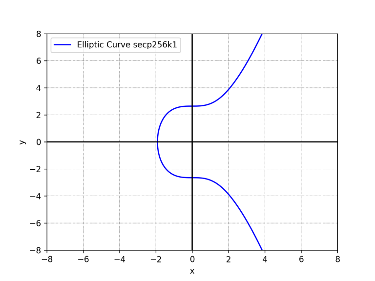

Chaves Públicas e Privadas são o coração do Bitcoin. Bitcoins são propriedades de Chaves Públicas, que exercem essa propriedade assinando transações para outras chaves. Essas assinaturas, por sua vez, dependem da Chave Privada.

Essa ligação *PrivKey* -&gt; *PubKey* -&gt; Assinatura é feita pela *Criptografia de Curva Elíptica(ECC)*. Ao aplicar uma função determinística — que resulta sempre o mesmo para a mesma saída — na Chave Privada, obtemos a Chave Pública. Nesse texto eu vou explicar que função é essa e por que ela é irreversível na prática. Ou seja, é humanamente impossível descobrir a Chave Privada de uma Chave Pública específica.

### Private Keys

Chaves Privadas são um número natural entre 1 e aproximadamente 10⁷⁷. Nada mais, nada menos. Chute um número dentro desse intervalo e você tem uma Chave Privada, simples assim. Quando um software de carteira de Bitcoin cria novas chaves, ele está usando funções específicas para gerar as chaves de forma determinística a partir de uma seed que foi escolhida aleatoriamente.

### Public Keys

A partir de uma Chave Privada, é possível derivar uma Chave Pública. Uma é consequência matemática da outra. O resultado de uma conta. Só isso. E essa conta é feita no espaço vetorial da curva elíptica.

*A curva elíptica tem esse formato*

Enquanto a *PrivKey* é um número, a *PubKey* é um ponto da curva em um plano cartesiano. Logo, ela tem coordenadas (x,y). A Chave Pública é um ponto obtido ao multiplicar a Chave Privada por um ponto inicial da curva arbitrariamente escolhido conhecido como G.

Lembrando que operações com vetores são diferentes de operações com números. Essa multiplicação que me refiro é uma repetição de somas (G+G+...+G) de G uma certa quantidade de vezes. A soma na curva elíptica é definida de forma diferente[^1], de forma que sabendo o ponto final e o ponto inicial G, você não tenha como saber **quantas vezes** o cálculo foi repetido.

Não existe um algoritmo que descubra esse número de somas(que é a *PrivKey*) de forma eficiente. Só o que você pode fazer é chutar valores e multiplicar por G e verificar se resultou na Chave Pública que está buscando(ou pelo menos uma que tenha fundos). Você teria que testar números entre 0 e 115792089237316195423570985008687907852837564279074904382605163141518161494337. **Boa sorte.**

Mesmo considerando que você não quer descobrir a *PrivKey* de uma *PubKey* específica, mas qualquer *PubKey* que tenha saldo(aproximadamente 38 milhões de endereços com um satoshi ou mais), ainda seria uma chance de 1 em 10⁷⁰. Seria como procurar um átomo específico em todo o universo.

Em suma, fica algo como **PubKey = PrivKey x Ponto G**(padronizado e público). A *Criptografia de Curva Elíptica* é o que permite que você possa expor sua Chave Pública sem medo na internet para, por exemplo, pesquisar o saldo dos seus endereços sem ter medo de alguém descobrir sua Chave Privada. Mais importante que isso, no entanto, é que a Chave Pública é necessária para a **prova de conhecimento da Chave Privada**, necessária para a assinatura de uma transação.

### Assinaturas

Assinar uma transação significa provar que você conhece a Chave Privada da qual a Chave Pública é derivada e cujo endereço tenha depósitos de bitcoin. Isso sem revelar sua Chave Privada, claro.

Na matemática existe um conceito chamado **Prova de Conhecimento-Zero**, onde você prova que sabe um segredo para outrem sem **jamais** dar possibilidade de o segredo ser descoberto. Assinaturas de transação formalmente não são Prova de Conhecimento-Zero pois a passagem de Chave Pública → Chave Privada pode ser feita com processamento suficiente, mas na prática funciona como se fosse.

Em termos técnicos, uma assinatura é um conjunto de um ponto na curva e um número (R, s) tal que satisfaçam a seguinte igualdade:

$$
s \cdot G = R + e \cdot PubKey \quad(1)
$$

onde “e” é o hash da transação. Pontos na curva são representados em letras maiúsculas. O ponto R é G multiplicado por um número aleatório k. “s” é criado pelo dono da Chave Privada da seguinte forma:

$$
s = k + e \cdot PrivKey \quad (2)
$$

Se eu multiplicar os dois lados por G fica:

$$
s \cdot G = k \cdot G + e \cdot PrivKey \cdot G \quad (3)
$$

Note que “kG” é a definição de R e “PrivKey x G” é a definição de Chave Pública. O assinante monta a equação 2, o verificador monta a equação 1. A equação 3 é o elo que une as duas. A igualdade só é verdadeira do lado do verificador se a PrivKey usada para criar “s” for a mesma que dá vida a PubKey com os fundos(implícito em “e”).

### Conclusão

A *Criptografia de Curva Elíptica(ECC)* é o que garante a posse soberana das suas chaves. E da próxima vez que você disser *“Not your keys, not your coins”* vai lembrar disso. A Chave Privada é o que determina o controle sobre seus bitcoins, por isso precisa de uma segurança absoluta. Essa segurança é feita pela *ECC*.

Para quebrar a *ECC*, não basta ter mais poder computacional que o resto da rede — como acontece em ataques ao consenso da blockchain[^2]. Seria necessário operar em escalas físicas absurdas ou descobrir um algoritmo capaz de inverter a multiplicação na curva, o que seria mais difícil ainda. E mesmo se um algoritmo do tipo fosse criado, os fundos de carteiras modernas não estariam perdidos automaticamente por um único detalhe: A Chave Pública não precisa ser exposta para receber pagamentos, apenas para fazê-los. Pretendo me aprofundar em carteiras em um texto futuro.

[^1]: Veja esse [artigo](https://estudiobitcoin.com/elliptic-curve-in-bitcoin/) em inglês que explica como a operação é definida. Está tão bem explicado que não tenho motivos pra reproduzir no meu texto.

[^2]: Nesse [artigo](https://substack.com/@danielloureno1/p-185122608) eu explico a vulnerabilidade da blockchain e como você só precisa de mais processamento que o resto da rede, bem menos que o necessário para quebrar a ECC
