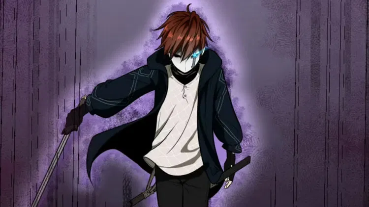
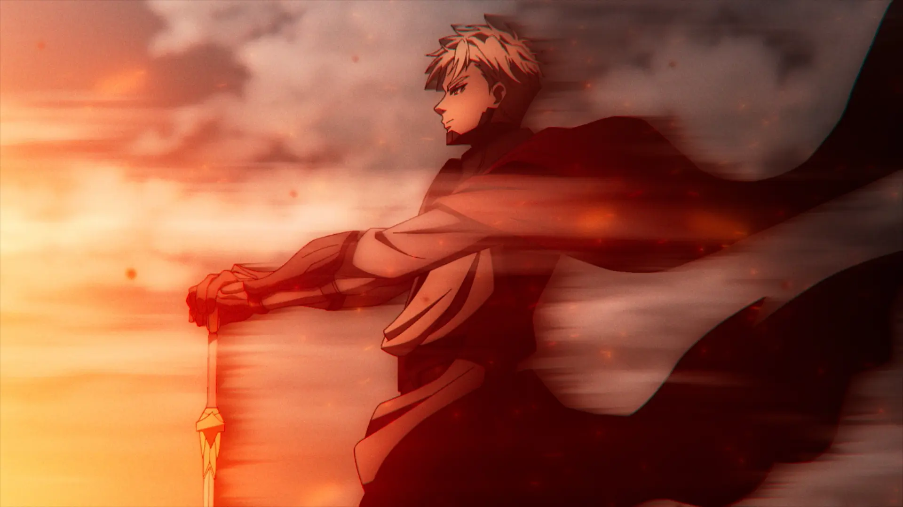
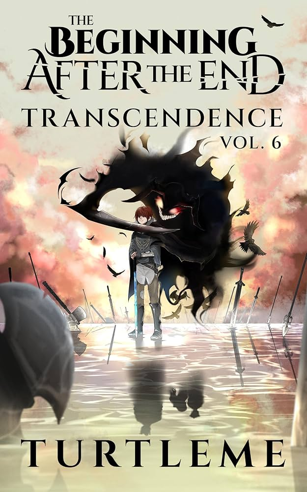

Antes rei lutador, agora reincarnado como Arthur Leywin em um mundo fantástico com belos genes e uma família amorosa. The Beginning After The End — que chamarei de TBATE de agora em diante — conta a história de um guerreiro que abandonou todas as suas amizades e amores em busca de poder para se vingar. Que morreu afogado em um vazio imensurável após concluir seu objetivo e que nessa nova vida aprende mais uma vez o que é o amor fraterno.

**Alerta de Spoilers!**

O começo da história mostra a infância de Arthur descobrindo mais sobre seus novos poderes nesse mundo enquanto convive com sua nova família e aprende o que é ter uma, já que ele era um órfão em sua vida passada.

Desde cedo ele percebe como o mundo é perigoso e como ele precisa de poder para proteger aqueles que ele ama. Existem inúmeros perigos, desde bandidos na estrada, tráfico humano e nobres com poder para saírem impunes de suas injustiças. E Arthur quer força para manter tudo isso longe dos seus pais, irmã e amigos.

Após uma experiência de quase morte ao defender sua família durante uma viagem, Arthur encontra Silvia, um ser estranhamente carinhoso e compreensível que destoa de sua aparência sombria e opressiva, que o ajuda a voltar para casa durante alguns meses. Silvia é gravemente feria por alguém de sua raça e deixa uma mensagem para Arthur, pedindo que ele não repita os erros da sua vida anterior ao procurar vingá-la. Que chegará o dia em que ele fará a diferença, mas que aproveite sua vida, sua infância e sua família até lá.

O protagonista segue esse pedido a risca, se tornando aventureiro e depois entrando na escola de magia, mas coisas estranhas continuam acontecendo: uma besta Rank S onde não devia, alunos com runas estranhas marcadas na pele, a descoberta de um novo continente e, por fim, uma general assassinada.

Os tempos de paz estavam chegando ao fim. Arthur continuou crescendo em força para lidar com as ameaças do mundo, mas não em maturidade para lidar com as dificuldades, que sempre serão maiores do que nós. Em sua vida passada afastou todas as pessoas que se importavam com ele, eliminando todas as suas fraquezas e se tornou invencível, mas perdeu o sentido de lutar. Agora, teria que lidar com a culpa de talvez ter acelerado uma guerra que só viria em um futuro distante.

Aluno da mais prestigiada academia de magia, amigo de príncipes e princesas dos reinos humanos e élficos, único mago quadra elemental. Arthur parte em um arco de treinamento e volta após o início da guerra.

Ele podia ser um dos combatentes mais fortes do continente, ser nomeado como general ou qualquer outra coisa, mas não tinha a capacidade para defender sua família da forma que desejava. Pensou que bastava ser forte o suficiente e todos os problemas poderiam ser contornados. Seus pais e irmã entram na guerra como soldados. Seu pai morre em uma batalha particularmente difícil. Sua namorada, Tessia, entra em crise em outra batalha. O reino élfico é invadido.

Sem tempo para chorar a morte do seu pai, Arthur é confrontado com uma das batalhas mais marcantes da guerra para mim: A batalha de Bloodfrost.

Nesse ponto a guerra já foi perdida para Arthur que perdeu parte da sua família. Isso o faz refletir sobre a proposta que ele tinha recebido do inimigo, Agrona, alguns dias antes: Deixar a guerra e ter sua família poupada.

Durante a batalha o castelo cai por conta da traição do rei elfo para salvar sua filha, Tessia. Assim como Arthur, Alduin teve sua grande perda na guerra: seu reino. Sua família era a única coisa que lhe restava e ela se encontrava com uma doença incurável.

Arthur sente algo esquisito na batalha, que só tinha escravos e nenhum soldado ou mago de verdade. Volta pro castelo e descobre a traição. Descobre também a força real dos generais inimigos, e que nunca tiveram nenhuma chance de vitória. Ele foge com os únicos sobreviventes no castelo para algum lugar qualquer perto de uma montanha e chora a derrota.

Seu pai tinha morrido alguns dias antes. Sua mãe e irmã estavam no castelo. Ele não sabia se tinham sido carbonizadas pelas mesmas chamas que mataram Silvia ou se tinham escapado e estavam fugindo assim como ele. A única coisa que restava para ele era sua companheira dragão que criou desde filhote, Silvie, e talvez Tessia.

Nessa situação ele faz algo inesperado movido pelo desespero. Contata Agrona aceitando o contrato sem nem mesmo saber se ainda tem uma família para proteger, entregando de bandeja um continente que já tinha sido conquistado de qualquer maneira.

Esse é o fundo do poço para o personagem. No futuro ele ainda ficaria mais ferido, mais fraco, com mais cicatrizes, mais cansado, mas nunca com tantas perdas como nesse momento.

TBATE é uma obra que acompanhei os lançamentos semanalmente alguns anos atrás com uma mente totalmente diferente da que tenho hoje. Lembro que na época o mais importante para mim, o que realmente ocupava minha mente, eram assuntos que hoje percebo serem menores.

A evolução de força do personagem era um deles. Ansiava pelo momento onde o protagonista dominaria sua vontade bestial e varreria o chão com a cara de seus inimigos. Isso veio, mas junto de momentos que os humanizavam.

Havia também bastante discussão entre torcidas organizadas sobre possíveis interesses amorosos do protagonista, sendo que era claro que ele terminaria com Tessia, sem a menor sombra de dúvida.

E ao mesmo tempo se desenvolvia no fundo de tudo isso um dilema que eu só daria importância depois. Algo que Arthur repetiu em suas duas vidas, mas que não percebi na época por simplesmente pular todos os flashbacks da vida passada dele. Afinal, eles eram inúteis para o desenrolar dos eventos, as batalhas e táticas de guerra no primeiro plano, mas fundamentais para entender a visão de mundo do personagem. Também é curioso como ele começa a ter pesadelos com a vida passada somente depois do início da guerra.

Arthur tem, desde o princípio, um desejo natural de afastar todo o mal daqueles que ele ama. E quando ele perde a primeira pessoa com quem se importou na vida passada, a diretora do seu orfanato, desvirtua toda sua vida em busca de vingança.

Aqui o dilema surge, ele ainda tem pessoas para proteger: seus amigos Nico e Cecilia. Mas ele decide se afastar de ambos, deixando de os proteger, porque os caminhos que ele trilharia seriam muito perigosos dali em diante. Porém, seus amigos não o abandonam e decidem trilhar esse caminho junto com ele, o que os leva para vidas terríveis e mortes prematuras.

De forma semelhante, nessa nova vida ele perde Silvia, mas decide fazer diferente, mostrando amadurecimento. Essa maturidade seria posta a prova quando ele perde outro amigo Elijah e quando perde seu pai, sua família, seu país. Durante toda essa nova vida ele sente o peso de tudo que ele precisa proteger e tenta carregar aquilo sozinho, acumulando fracassos no processo.

A obra me pegou pelas lutas e sistema de combate, mas me segurou pelo desenvolvimento dos personagens, ou a falta dele em muitos casos, o que é bem humano na verdade.

Arthur é cabeça dura e se apoia no seu tempo somado de duas vidas para fantasiar sua teimosia como experiência. Tessia faz de tudo para se sentir menos inútil como princesa, participando nas linhas de frente da guerra. O ódio irracional que Nico e Cecilia alimentam por Arthur. A manipulação de Agrona sobre o psicológico de personagens nos dois continentes. Algumas poucas disputas políticas bem localizadas. Esses são só alguns exemplos.

Outro grande arco para mim acontece quando ele tem que se infiltrar no continente inimigo, interagindo tanto com camponeses quanto militares e líderes. O foco do personagem é conseguir voltar para casa o mais rápido possível, mas você nota capítulo a capítulo o pensamento dele mudando e ele lutando contra isso.

Não digo que a história é a melhor de todos os tempos, mas com certeza é uma das quais eu mais engajei e, por isso, tive tempo para notar o que vai além do óbvio.

OBS: **Não vejam o anime, é horrível**. Além de que tudo que eu descrevi demoraria anos de adaptação para chegar, se é que chegará.

Eu consumi muitas histórias na minha adolescência e com o último texto sobre Attack on Titan percebi que foi um entretenimento, mas que pode ser aproveitado retroativamente também. Sempre posso revisitar aquelas memórias e analisar outros pontos de vista. Foi o que tentei fazer em ambos os textos.

> [Ciclo de Ódio em Attack On Titan](https://substack.com/home/post/p-191869196)
>
> Há cerca de 100 anos surgiram os titãs, seres humanoides variando entre 3 e 15 metros de altura, o que causou a quase extinção da humanidade. Ou pelo menos era isso que pensávamos até o fim da terceira temporada do anime.
