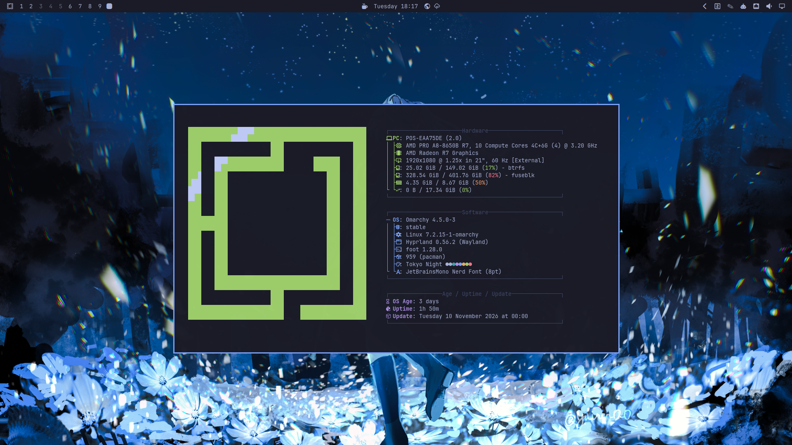
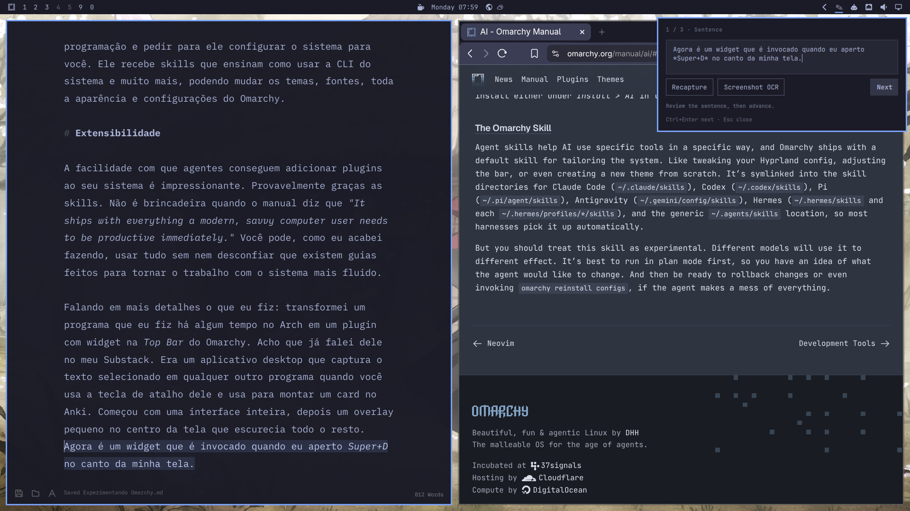
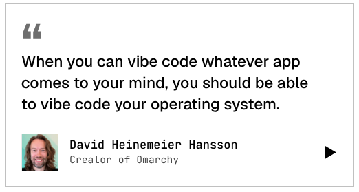
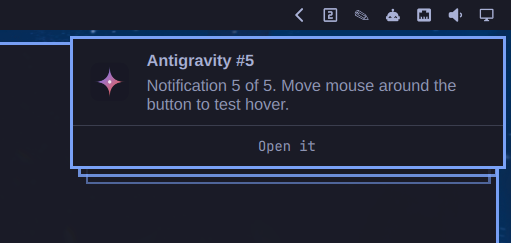
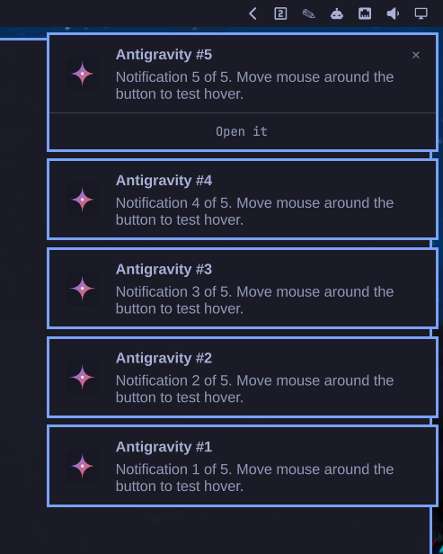

Aqui eu vou relatar a instalação, o uso e as minhas impressões sobre Omarchy, um sistema operacional baseado em Arch Linux.

Minha trajetória com sistemas operacionais começou com o Windows 10. Instalei Ubuntu pela curiosidade de usar uma distribuição Linux. Instalei Arch para saber se era realmente tão difícil de instalar quanto diziam.

Pelo que entendi, o Omarchy não se vende como uma distro mais customizável do que qualquer outra, mas como um sistema completo para desenvolvimento. Você instala e usa de forma rápida. Não foi bem o meu caso, mas já eu chego lá.

De certa forma, o Omarchy foi um dos sistemas operacionais que mais me deu trabalho e, ainda assim, o mais fácil de se instalar.



## Instalação

É bem simples. Monte uma mídia bootavel com o ISO oficial e faça boot por ela. Nada de linha de comando como Arch, nada de infinitas perguntas sobre drivers e dispositivos como Ubuntu ou particionamento como numa instalação Windows. Ele pede idioma, layout de teclado, nome de usuário e senha em uma interface simples e agradável. Depois pergunta o disco onde você deseja instalar o Omarchy e se deseja formatar ou usar apenas o espaço livre. Bem simples, na teoria.

Na prática, tive alguns problemas. Imagino que seja um processo de instalação imensamente simples quando você não precisa se preocupar com configurações anteriores e está em uma máquina completamente nova. O meu caso concreto era um dual boot onde eu queria adicionar um terceiro sistema operacional.

Para completar, meu SSD ainda usava MBR como sistema de partições. Teoricamente suportado pelo Omarchy, mas só com uma formatação completa do disco - até onde eu pude verificar. A opção de instalar no espaço livre não existe pois a instalação precisa configurar a partição inicial do disco, que deve obrigatoriamente ser EFI.

Finalmente, com 150 GB de espaço livre, disco convertido de MBR para GPT com a ajuda do comando *mbr2gpt* do Windows, tendo verificado se meu dual boot continuava funcionando em UEFI, pude começar a instalação da forma que queria. Foram poucos minutos até o sistema estar instalado e funcionando.

## Curva de Aprendizado

A forma como usava meu Arch era com todas as janelas ocupando a tela inteira e uso excessivo de *Alt+Tab*, o que gerou um desgaste que só percebi quando experimentei algo diferente. O Omarchy usa o *Hyprland* para gerenciar as *tiling windows*, que são basicamente janelas que se auto-redimensionam conforme são abertas ou fechadas.

Quando novas janelas abrem dividindo o espaço da tela entre si, é quase impossível não perceber que algumas coisas não precisam da minha tela inteira.

Além disso existem os atalhos, que não são somente atalhos, mas a forma que se espera que você use o sistema. Sem dúvida o atalho que eu mais utilizei até agora foi o *Super+K* que me lista todas as *Keybindings*.

O ambiente também me forçou a usar *Workspaces* que já existem no Arch Linux, mas que são necessários quando você não pode abrir indefinidos programas na mesma tela.

## Coisinhas Legais

O sistema é cheio de pequenos detalhes legais como os widgets na *Top Bar*, *Web Apps*, Reminders, gravação de tela e teste de internet embutidos, digitação por fala, reconhecimento de texto em imagens (OCR), atalhos globais para clipboard e histórico.

Esses detalhes e muitos outros integram-se à interface de forma agradável. É definitivamente um sistema que dá gosto de se usar.

> We’re serious people, doing serious work, but if we can’t laugh at ourselves and the delusional mission, it gets stuffy and stale real quick. We need fun, we need whimsy, we need cool for its own sake. The computer needs easter eggs, it needs silly games, it needs funny pun songs. Serious people have serious fun. - [Have some fun](https://omarchy.org/doctrine/#have-some-fun)

## Controle

O sistema disponibiliza uma CLI padrão onde você (ou um agente ou um script) pode controlar cada pequena parte dele através da linha de comando.

Um exemplo onde isso seria útil é ignorar a própria seção *Learn* do menu principal, abrir um agente de programação e pedir para ele configurar o sistema para você. Ele recebe skills que ensinam como usar a CLI do sistema e muito mais, podendo mudar os temas, fontes, toda a aparência e configurações do Omarchy.

## Extensibilidade

A facilidade com que agentes conseguem adicionar plugins ao seu sistema é impressionante. Provavelmente graças às skills. Não é brincadeira quando o manual diz:

> *It ships with everything a modern, savvy computer user needs to be productive immediately.* *Your agent should feel at home on your computer. Omarchy gives it the tools and skills to help you understand, fix, and shape the whole system.*

Você pode, como eu acabei fazendo, usar tudo isso sem nem desconfiar que existem guias feitos para tornar o trabalho com o sistema mais fluido.

Falando em mais detalhes o que eu fiz: transformei um programa que eu fiz há algum tempo no Arch em um plugin com widget na *Top Bar* do Omarchy. Acho que já falei dele no meu Substack. Era um aplicativo desktop feito em Rust que captura o texto selecionado em qualquer outro programa quando você usa a tecla de atalho dele e usa para montar um card no Anki. Começou com uma interface inteira, depois um overlay pequeno no centro da tela que escurecia todo o resto. Agora é um widget que é invocado quando eu aperto *Super+D* no canto da minha tela.



*Minha tela enquanto escrevo esse artigo. Omawrite na metade esquerda da tela, manual do Omarchy na direita. Minha widget no canto superior direito. Sempre disponível.*

Tomei alguns sustos quando meu agente reiniciou o Omarchy shell para carregar o meu plugin e minha *Top Bar* sumia junto com meu Wallpaper, mas o resultado final ficou limpo e funcional quase sem intervenção.

## Filosofia do Omarchy



Isso se liga à seção anterior sobre extensibilidade. Uma coisa engraçada é que boa parte do texto foi escrito apenas do meu uso do Omarchy, mas quando abri o site oficial para usar de referência, encontrei exatamente as mesmas coisas que escrevi declaradas como princípios. [Princípios](https://omarchy.org/doctrine/) que foram seguidos, eu diria.

Se tivesse que explicar com minhas palavras, a filosofia do Omarchy é: Façamos o sistema operacional definitivo. Não existe desculpa para deixar como está, mesmo o menor dos detalhes. Você tem toda a liberdade e a **facilidade** para customizar e **extender** o Omarchy.

## [Unite the nerds](https://omarchy.org/doctrine/#unite-the-nerds)

DHH quer unir os talentos do mundo linux para construir o sistema dominante do ambiente desktop.

## [Beauty is truth](https://omarchy.org/doctrine/#beauty-is-truth)

> Make it shine, make it wow, make it art.

A aparência, além de ser um detalhe da ferramenta, determina em parte a utilidade percebida. O sistema é bonito. Digo isso por mim.

## [Welcome the agents](https://omarchy.org/doctrine/#welcome-the-agents)

> Agents are welcome everywhere. In the code, in the issues, in the pull requests, and in the infrastructure.

## Uma segunda qualquer

Aquele widget na *Top Bar* não foi a única coisa que me atrevi a fazer. Com agentes trabalhando nos meus projetos, acabo verificando o andamento da tarefa de minuto em minuto. Por isso resolvi criar um sistema de notificações para meus agentes.

OpenCode tem um aviso sutil em formato de som que nunca gostei. Descobri depois que o Codex Desktop, diferente do Codex CLI, tem exatamente o tipo de notificação que eu fiz para os outros.

Era algo bem mais simples que um widget. Só precisaria de um pequeno script para cadastrar hooks que são ativados em certos eventos do programa que roda o agente. Hooks personalizados para cada agente ativam o mesmo código que dispara uma notificação no meu sistema.

Funcionou bem. Resolvi colocar um botão naquela notificação e isso acabou me levando para outra pequena aventura.

## Contribuindo com Omarchy

<!-- vídeo nativo do Substack não migrado -->

Encontrei essa... estranheza nas notificações do sistema. Quando eu aproximava o mouse das bordas, o botão encolhia rapidamente.

Todo o problema estava num operador ternário que dizia se o botão aparecia ou não na notificação.

```text
expanded ? hovered : front
```

Ele só faz sentido se você entender que notificações são agrupadas em grupos, que são chamados de decks.





*Expanded* se refere ao estado do deck. *Hovered* diz para qual notificação o mouse está apontando. *Front* é a primeira das notificações. A verificação acontece o tempo todo para cada notificação, que vou chamar de card daqui em diante.

Se o mouse sai completamente do deck, *expanded* se torna falso e somente o *front* tem seus botões mostrados. O problema está em *hovered* se tornar falso antes do deck encolher.

Tudo isso acontece mesmo com decks de um único card. *Hovered* fica falso, o card encolhe. O deck encolhe e botão reaparece. Chamei isso de pulso e acontece sempre que o mouse sai da notificação.

Já o loop acontecia pois enquanto o mouse se aproximava do card, o deck expandia antes (quatro pixels, para ser exato) do mouse chegar no card. O ciclo é: Mouse expande o deck, mouse não está no card, então ele oculta seus botões, então o card diminui juntamente com o deck. Sem se mover, o mouse sai do deck. Em um deck não expandido, o primeiro card mostra seus botões, aumentando o tamanho do deck e englobando o mouse novamente.

Gastei uma ou duas horas diagnosticando a origem do problema. Esse problema só tremia o card e não impedia em nada a utilidade da notificação, mas entendi que um bug visual seria uma boa forma de fazer minha primeira contribuição para o Omarchy e open source no geral.

Clonei o repositório, apliquei minhas correções reformulando a forma como a decisão do que era oculto ou expandido era feita, que era de responsabilidade do próprio card. Agora o botão já é chamado recebendo como parâmetro se deve ou não mostrar seus botões e eliminei completamente o operador ternário.

Aqui vem a parte que achei mais interessante do processo: Apliquei as alterações no código do repositório clonado, depois troquei o clone com o meu sistema rodando. Comprovei que a aplicação corrigia o bug e enviei o Pull Request pedindo que minha alteração seja aplicada no repositório original.

<!-- vídeo nativo do Substack não migrado -->

Não fiz essa contribuição para provar um ponto. Só segui minha curiosidade e descobri a compatibilidade das premissas do projeto com meus próprios interesses.

## Conclusão

Omarchy é bonito, prático e extensível de uma forma que não enxerguei no Ubuntu ou no Arch Linux. O sistema ser maleável não é garantia de nada e pode piorar com o tempo. Pode até seguir uma linha que eu desgoste, mas só consigo dizer que é incrível agora.
