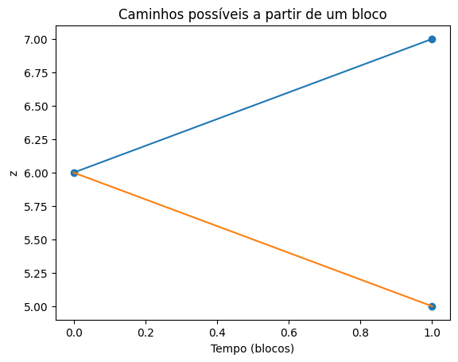
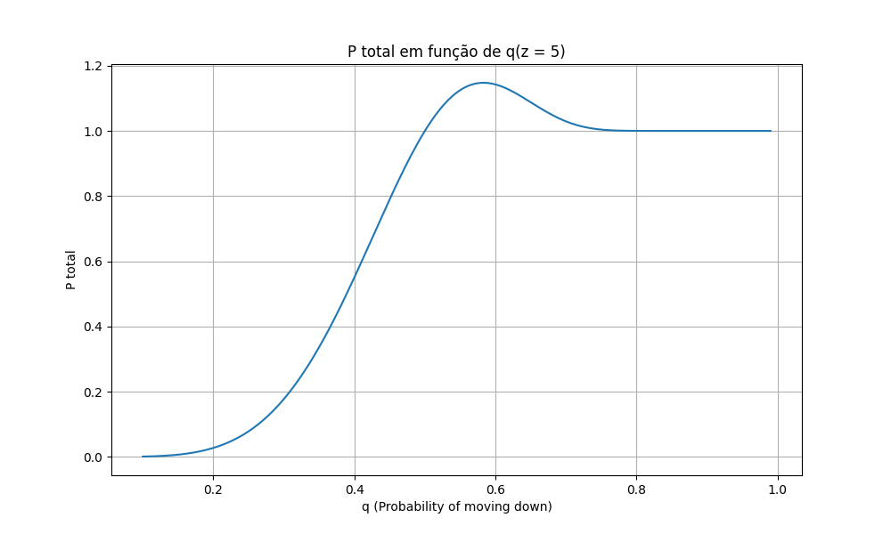
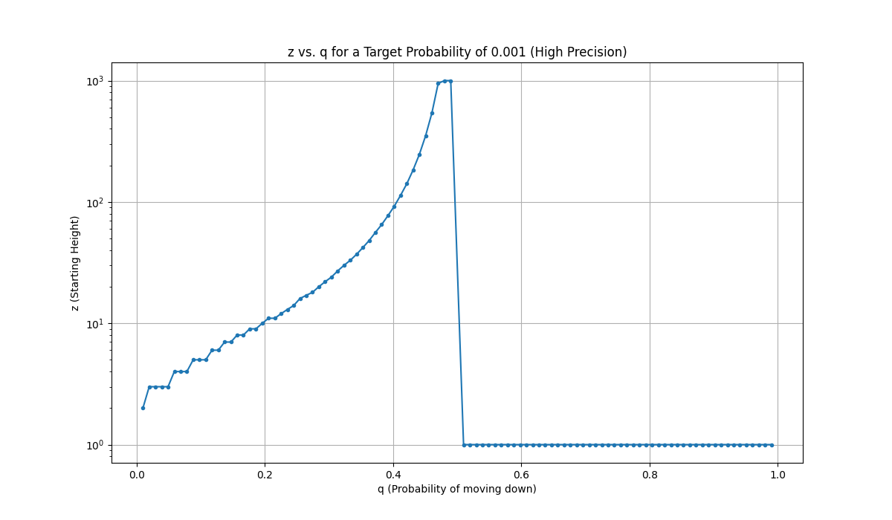

Estou terminando uma disciplina de estatística que me dá ferramentas para analisar probabilidades associadas à variáveis aleatórias com certos tipos de distribuições. Nesse texto quero aplicar esse conhecimento em um exemplo do mundo real para solidificar o meu aprendizado e trabalhar em um tema que acho interessante.

No white paper do Bitcoin, Satoshi avalia as probabilidades de um atacante modificar a blockchain para tentar desfazer seus próprios pagamentos, ficando com o dinheiro e o produto comprado. Ele conclui que, desde que o atacante tenha menos poder computacional que o resto da rede combinada, é seguro dizer que transações incluídas há certa quantidade de blocos são estatisticamente impossíveis de reverter. A seguir vou analisar as ferramentas que ele usou para concluir isso.

### Sobre o ataque

Antes disso, é importante definir por que especificamente esse tipo e ataque é considerado. Por que não alterar a blockchain para desviar os bitcoins das transações alheias para si?

Uma das regras primordiais do Bitcoin é que outputs(UTXO) estão ligados a endereços. Endereços ligados à Chaves Públicas que estão ligadas à Chaves Privadas por Criptografia de Curva Elíptica e SHA-256. Muita matemática para dizer, em resumo, que bitcoins tem dono e só ele pode assinar uma transação. Mesmo que um minerador — um atacante montando um bloco falso — crie uma transação de qualquer endereço para um endereço dele e inclua no bloco, ele não será capaz de criar uma assinatura válida para a transação e o bloco inteiro será rejeitado por todos os nós da rede.

Vimos que ele não pode criar transações partindo de endereços que ele não controla. Só resta remover transações existentes em um bloco válido o substituindo por um bloco sem elas. Isso ainda é ineficaz com transações alheias. Uma vez assinada, uma transação pode ser adicionada a qualquer momento em um bloco. Se a transação já se espalhou pela rede, fazer uma corrente de blocos alternativa sem ela é adiar o inevitável. Assim, só resta como alternativa substituir um pagamento feito pelo próprio atacante para alguém por um pagamento para outro endereço próprio. Isso torna a primeira inválida se a corrente alternativa for adotada como definitiva.

### Passeio aleatório

Em um passeio aleatório, a tendência quando o experimento é repetido uma quantidade massiva de vezes é que não saia do mesmo lugar. Imagine um bêbado andando em uma estrada sempre para frente, mas tropeçando para os lados. Ora ele dá um passo para a esquerda ora para a direita. Passeios aleatórios seguem a distribuição binomial que é bem conhecida no campo da estatística.

Supondo que o dito bêbado tem a mesma chance de dar um passo para a esquerda ou para a direita. Pegamos a probabilidade de um evento (nesse caso dar um passo a esquerda) acontecer e chamamos de *p*. A probabilidade desse evento acontecer *k* vezes em *n* tentativas é dada por:

$$
P(k,n,p) = \frac{n!}{k!(n-k)!} \cdot p^k \cdot (1-p)^{n-k}
$$

Para n = 1 e k = 1, P(1,1,p) = p, como definimos. Isso significa: **A chance do próximo passo lateral ser para a esquerda é p**

Aplicando para o Bitcoin, o evento pode ser um atacante descobrir o hash de um bloco, estendendo uma cadeia de blocos modificada. Isso funciona porque a descoberta do hash que torna um bloco válido é um evento probabilístico onde a probabilidade é proporcional ao seu poder computacional. *q* seria a porcentagem do poder da rede que o atacante possui. Podemos igualar k e n, resultando na seguinte fórmula:

$$
P(k,q) = 1 \cdot q^k \cdot (1-q)^{0} = q^k
$$

Lê-se: A probabilidade P de um atacante minerar k blocos seguidos é a porcentagem q do Hashrate elevado a k.

Como q é um número entre 0 e 1. P(k,q) fica bem pequeno conforme o número de blocos aumenta. Mas isso não importa pois um atacante não precisa minerar k blocos seguidos. Ele só precisa que a cadeia adulterada eventualmente fique maior que a cadeia formada pelos mineradores honestos, não importa quanto tempo demore.

Vamos montar isso passo a passo. Imagine a distância entre a cadeia de blocos honesta e a cadeia do atacante como um número. Se elas tem o mesmo tamanho, essa distância é zero. Se nós honestos estenderem a cadeia a distância aumenta e vira 1, caso contrário -1.

O atacante precisa esperar uma quantidade z de blocos honestos serem minerados antes de começar.

q\_z = chance de uma distância z&gt;0 virar 0, ou seja, atacante alcançar nós honestos

Independente do histórico passado, as chances do próximo evento é estático. p é a chance da cadeia honesta ser estendida.

$$
q_z = p \cdot q_{z+1} + q \cdot q_{z-1}
$$

onde q(z+1) é uma situação mais difícil pro atacante - ele terá uma desvantagem de z+1 blocos - e q(z-1) é uma situação mais fácil para o atacante - ele terá uma desvantagem de z-1 blocos.

Perceba que q\_z é um lugar inicial com uma bifurcação que leva para dois caminhos distintos. *p* e *q* são a probabilidade de seguir por cada caminho.

*A linha azul tem probabilidade p de ser seguida. A outra tem probabilidade q*

Podemos transformar o problema em um problema quadráfico da seguinte maneira:

$$
\begin{align*}
q_z &= r^z\\

q_{z+1}&=r^{z+1}\\

q_{z-1} &= r^{z-1}\\

r^z &= p \cdot r^{z+1} + q \cdot r^{z-1}\\

r &= p \cdot r^{2} + q\\

0&=p \cdot r^2 - r + q\\
\end{align*}
$$

Resolvendo a equação temos que r = 1 ou

$$
r= \left( \frac{q}{p} \right)
$$

Então

$$
\begin{align}
q_z &= 1^z\\
q_z &= \left( \frac{q}{p}\right)^z\\
\end{align}
$$

exatamente como Satoshi concluiu.

Falando de forma gráfica, q\_z é a chance do gráfico descer até o eixo x. A chance dele cair até zero algum dia, no futuro.

No tempo entre o pagamento e o recebimento do produto a rede irá criar *z* blocos enquanto o atacante vai criar sua própria versão em paralelo. Para calcular quantos blocos o atacante minerou nesse tempo precisamos de outra distribuição.

A distribuição de Poisson serve para calcular a probabilidade de um evento raro acontecer k vezes em um intervalo fixo. É necessário que os eventos sejam independentes. É necessário também conhecer a taxa média de ocorrência do evento. Chamamos essa taxa de λ que é dada por:

$$
\lambda = z \cdot \frac{q}{p}
$$

A probabilidade é dada por:

$$
P(K=k)= \frac{\lambda^k \cdot e^{-\lambda}}{k!}
$$

Agora sabemos a chance do atacante ter minerado $k$ blocos, que vai de 0 até infinito, com probabilidade decrescente. E a distância agora fica como z-k. Caso *k* seja maior que *z* o atacante já ganhou a corrida e o ataque foi um sucesso. Essa probabilidade é dada por:

$$
P(K > z) = 1 - P(K < z) = 1 - \sum_{i=0}^{z}{\frac{\lambda^i \cdot e^{-\lambda}}{i!}}
$$

Basta somar a probabilidade de k ser maior que z com a probabilidade seguinte. A próxima probabilidade que nos interessa é a de k ser menor que z e, mesmo assim, o atacante ultrapassar z. Isso pode ser encontrado simplesmente multiplicando q\_z por P(K &lt; z). Somando tudo fica:

$$
\begin{align}

P_{total} 

&= 1 - P(K<z) + q_z \cdot P(K<z)\\

&= 1 + P(K<z)(q_z - 1)\\

&= 1 - P(K<z)(1 - q_z)\\

\end{align}
$$

Essa é exatamente a última fórmula do white paper, mas com substituindo P(K&lt;z) e q\_z por seus respectivos valores. Note que q\_z aqui não é a chance de ultrapassar uma distância z mas sim uma distância z-k.

O que vimos nesse texto foi que a corrida entre nós honestos e atacante se comporta como uma variável aleatória binomial, mas isso é insuficiente para calcular a probabilidade do ataque ser bem sucedido. É preciso apelar para a distribuição de poisson. Ptotal encontrado é a probabilidade do ataque ser bem sucedido. Seu complemento é a chance de ser mal sucedido, e é simplesmente:

$$
P_{complemento} = P(K<z)(1 - q_z)
$$

Leia-se: A probabilidade do ataque falhar é a chance do atacante minerar menos blocos durante a espera vezes a chance dele não alcançar uma distância de z-k blocos. Talvez o ocultamento das fórmulas concretas e específicas ajude a entender o raciocínio macro.

Podemos, assim como no white paper, fazer as contas com computador. Podemos fixar um Ptotal pequeno o suficiente e calcular qual z satisfaz essa probabilidade em função de q.

*Probabilidade de ataque bem sucedido em função de hashrate do atacante*

*Número de blocos necessários para tornar a transação irreversível para um atacante com porção q do hashrate total*

Nem eu esperava que a disciplina se encaixasse tão bem com esse aspecto. Tanto os resultados teóricos quanto os cálculos computadorizados indicam que o risco de ataque é bem baixo enquanto q é menor que 0.5. Apesar de z explodir para valores muito próximos a q=0.5 pela esquerda, isso não ficou bem representado pela natureza discreta dos cálculos.

Comecei pensando em escrever sobre bitcoin, mas o que predominou foi a matemática. Aprendi poucas coisas, confirmei muito do que já sabia e o mais importante: pude aplicar um conhecimento e ferramentas da engenharia em um problema real.
