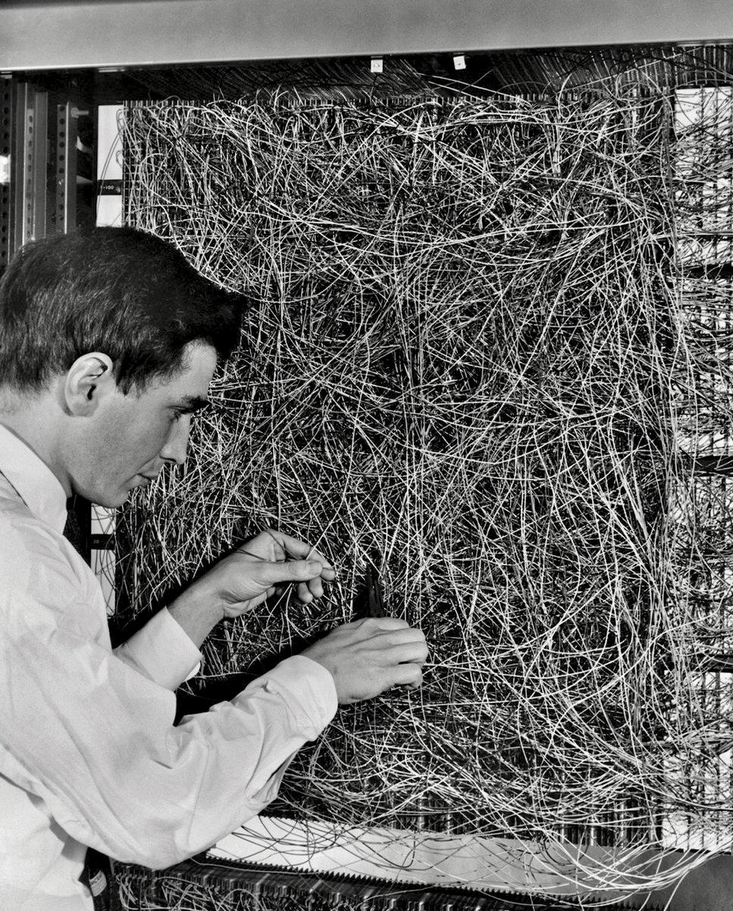

Acredito que entender o que há debaixo do capô ajuda tanto no compreendimento geral — para onde estamos indo agora que a tecnologia existe — quanto para melhor proveito do que já temos. Particularmente me incomoda quando proclamam o fim dos empregos para IAs que automatizarão o trabalho ou que atingiremos a AGI[^1] em um futuro próximo sem mais dificuldades.

Para começar vou explicar o processo para a rede neural mais clássica de todas. É como o *Hello Word*[^2] dessa área. A ideia não é ser estritamente técnico, mas dar uma noção para quem acha que é algo quase etéreo.

> Qualquer tecnologia suficientemente avançada é indistinguível de magia. (Arthur C. Clarke)

## O Problema

O problema XOR é simples: dadas duas entradas binárias, a saída é 1 se elas forem diferentes, e 0 se forem iguais.

```plaintext
A | B | A XOR B
--|---|--------
0 | 0 |    0
0 | 1 |    1
1 | 0 |    1
1 | 1 |    0
```

Nenhuma linha reta separa os casos onde a saída é 0 dos casos onde é 1. XOR não é linearmente separável, o que o torna o exemplo clássico para justificar redes com mais de uma camada. Diferente de um AND, por exemplo, onde é fácil da rede criar uma relação de proporcionalidade com os dados:

```markdown
A | B | A AND B
--|---|--------
0 | 0 |    0
0 | 1 |    0
1 | 0 |    0
1 | 1 |    1
```

## O Modelo

A rede que vamos treinar tem essa estrutura:

- **Camada de entrada**: 2 neurônios (os valores de A e B)
- **Camada oculta**: 2 neurônios
- **Camada de saída**: 1 neurônio

Em cada neurônio o que existe é uma série de multiplicações e uma soma. Cada conexão entre neurônios tem um **peso**, e cada neurônio tem um **viés**. A operação é:

```text
saída = ativação( entrada₁×peso₁ + entrada₂×peso₂ + viés )
```

A função de **ativação** é o que introduz não-linearidade na rede — sem ela, empilhar camadas não ajudaria em nada, porque a rede seria só uma função linear proporcional a entrada. Usamos a sigmoide, que comprime qualquer valor real para o intervalo (0, 1):

```text
sigmoid(x) = 1 / (1 + e^(-x))
```

O código abaixo implementa tudo isso do zero, sem nenhuma dependência externa. Todos os cálculos são feitos à mão:

```python
import random
import math

# ── Funções base ──────────────────────────────────────────────

def sigmoid(x):
    return 1.0 / (1.0 + math.exp(-x))

def forward(inputs, weights_hidden, bias_hidden, weights_out, bias_out):
    # Camada oculta: 2 neurônios
    h0 = sigmoid(inputs[0]*weights_hidden[0][0] + inputs[1]*weights_hidden[0][1] + bias_hidden[0])
    h1 = sigmoid(inputs[0]*weights_hidden[1][0] + inputs[1]*weights_hidden[1][1] + bias_hidden[1])

    # Camada de saída: 1 neurônio
    out = sigmoid(h0*weights_out[0] + h1*weights_out[1] + bias_out)
    return out

def loss(weights_hidden, bias_hidden, weights_out, bias_out):
    # Dados XOR
    data = [([0,0], 0), ([0,1], 1), ([1,0], 1), ([1,1], 0)]
    total = 0.0
    for inputs, target in data:
        pred = forward(inputs, weights_hidden, bias_hidden, weights_out, bias_out)
        total += (pred - target) ** 2  # erro quadrático
    return total / len(data)

# ── Inicialização aleatória ───────────────────────────────────

random.seed(42)
weights_hidden = [[random.uniform(-1, 1) for _ in range(2)] for _ in range(2)]
bias_hidden    = [random.uniform(-1, 1) for _ in range(2)]
weights_out    = [random.uniform(-1, 1) for _ in range(2)]
bias_out       =  random.uniform(-1, 1)

# ── Treinamento por passo aleatório ──────────────────────────

best_loss = loss(weights_hidden, bias_hidden, weights_out, bias_out)

for step in range(100_000):
    # Escolhe um peso aleatório para perturbar
    layer = random.choice(['hidden', 'out', 'bias_h', 'bias_o'])

    if layer == 'hidden':
        i, j = random.randint(0,1), random.randint(0,1)
        old = weights_hidden[i][j]
        weights_hidden[i][j] += random.uniform(-0.1, 0.1)
        new_loss = loss(weights_hidden, bias_hidden, weights_out, bias_out)
        if new_loss < best_loss:
            best_loss = new_loss
        else:
            weights_hidden[i][j] = old  # reverte

    elif layer == 'out':
        i = random.randint(0,1)
        old = weights_out[i]
        weights_out[i] += random.uniform(-0.1, 0.1)
        new_loss = loss(weights_hidden, bias_hidden, weights_out, bias_out)
        if new_loss < best_loss:
            best_loss = new_loss
        else:
            weights_out[i] = old

    elif layer == 'bias_h':
        i = random.randint(0,1)
        old = bias_hidden[i]
        bias_hidden[i] += random.uniform(-0.1, 0.1)
        new_loss = loss(weights_hidden, bias_hidden, weights_out, bias_out)
        if new_loss < best_loss:
            best_loss = new_loss
        else:
            bias_hidden[i] = old

    else:
        old = bias_out
        bias_out += random.uniform(-0.1, 0.1)
        new_loss = loss(weights_hidden, bias_hidden, weights_out, bias_out)
        if new_loss < best_loss:
            best_loss = new_loss
        else:
            bias_out = old

# ── Inferência ───────────────────────────────────────────────

print(f"Erro final: {best_loss:.4f}\n")
for inputs, target in [([0,0], 0), ([0,1], 1), ([1,0], 1), ([1,1], 0)]:
    pred = forward(inputs, weights_hidden, bias_hidden, weights_out, bias_out)
    print(f"{inputs} → {pred:.3f}  (esperado: {target})")
```

**Treinamento** é o loop de 100 mil passos. Em cada iteração, o algoritmo escolhe um peso qualquer da rede e o altera um pouco. Depois calcula o erro total sobre todos os quatro exemplos XOR. Se o erro caiu, mantém a mudança. Se piorou, reverte. Simples assim — nenhuma matemática sofisticada, só tentativa e erro.

**Inferência** é o que acontece depois do treino, quando a rede já está pronta — entenda rede como um conjunto de pesos e vieses, nesse caso 6 pesos e 3 vieses. Você passa uma entrada pelo `forward` e lê a saída. Nenhum peso muda. A rede agora é uma função fixa que aprendeu a imitar o padrão.

**A função de erro** (ou loss) mede o quão longe as previsões estão das respostas certas. Aqui usamos o erro quadrático médio: para cada exemplo, eleva ao quadrado a diferença entre o que a rede previu e o que era esperado, e tira a média. Quanto menor, melhor.

O resultado após o treino se parece com isso:

```text
Erro final: 0.0023

[0, 0] → 0.047  (esperado: 0)
[0, 1] → 0.956  (esperado: 1)
[1, 0] → 0.957  (esperado: 1)
[1, 1] → 0.051  (esperado: 0)
```

A rede não memorizou uma tabela. Ela encontrou pesos que, quando combinados pelas operações matemáticas de cada neurônio, produzem os valores certos. Isso é o que existe dentro de qualquer rede neural, independente do tamanho.

> **Observação**: técnicas como o gradiente descendente — que ao invés de alterar os pesos às cegas calculam a direção exata em que cada peso deve se mover para reduzir o erro — dão um salto enorme na velocidade e eficiência do treinamento. Mas o objetivo é o mesmo: encontrar os pesos certos. O método muda, a essência não.

O resultado desse processo, quando o erro fica abaixo de um certo limite aceitável, é uma rede capaz de prever o padrão nos dados de treino.

Coisas como número de neurônios são diretamente proporcionais ao número de padrões que podem ser potencialmente aprendidos (existe um fator exponencial aqui).

## Modelos de Linguagem

Uma *LLM(Large Language Model)* é um modelo de rede neural grande feito para aprender **padrões de linguagem**. Ele tem uma estrutura em camadas com neurônios que fazem as mesmas operações que acabei de descrever. São multiplicações e somas. O que muda? Os dados de treinamento.

LLMs são treinadas com quantidades colossais de textos escritos por humanos. Até que ponto uma máquina é inteligente por imitar padrões criados por uma inteligência real?

Qual a diferença entre imitar esse padrão e reproduzir um debate ou discurso altamente inteligente em texto ou vídeo? Estou falando de reprodutor mesmo, no sentido de arquivos de vídeo ou `.txt`.

Claramente existe uma diferença aqui. A adaptabilidade. LLMs já se mostraram úteis para resolver **novos** **problemas** pela aplicação de técnicas **já conhecidas**. Encaixando um padrão no outro ela consegue gerar uma resposta e manter uma conversa totalmente nova a cada vez.

## Treinamento

O treinamento é apenas ajuste de parâmetros — pesos e vieses, que serão multiplicados e somados — então existe um processo ordenado. Saímos de parâmetros aleatórios para uma sequência bem específica que processa entradas em saídas desejadas.

*Overfitting* é um problema bem conhecido que descreve quando o treinamento passou do ponto. É quando o treinamento dura demais fazendo o modelo ficar tão preso aos dados do treinamento ao ponto de ser inútil para outros dados que ele nunca viu.

*Overfitting* vs Generalização é um balanço bem subjetivo que depende do uso que farão do modelo. Prender-se aos dados te dá respostas objetivamente **mais confiáveis**, mas cada vez **mais inúteis** para problemas novos. Do outro lado da moeda, treino de menos faz um modelo flexível de mais, que não internalizou padrões e não fala coisa com coisa.

Comparar o modelo do exemplo com LLMs é como comparar o conceito de formas básicas do desenho com o teto da Capela Sistina. É comparar um bebê aprendendo a andar e um ginasta olímpico. Ainda assim, existe semelhança na essência da atividade. A diferença não é qualitativa, a ação não mudou. É quantitativa, a potência mudou.

Sei que o exemplo que dei é simples, mas quero tentar extrapolar para redes maiores, da ordem de centenas de bilhões de pesos, tipo os modelos comerciais como ChatGPT e Claude. O *input* é o contexto da conversa, são todos os tokens/palavras ditos até agora, seja por você ou por ele mesmo. O *output* é o próximo token.

A inferência é calcular tokens, um seguido do outro até chegar ao fim da resposta. No cálculo do segundo token, o *input* é o primeiro. No cálculo do terceiro, o *input* são os dois primeiros tokens. Assim por diante.

Qual é o processo de treinamento? É feito com textos de livros, artigos, blogs, tutoriais e tudo mais que está disponível na internet, tomando os devidos cuidados com copyright e propriedade intelectual. Esses textos são dados para a IA da mesma forma que expliquei antes. Depois de um chunk de treinamento ser feito a *função loss* calcula o erro de todas as inferências e é feito um cálculo de quais pesos mudar para diminuir o erro médio em todas as amostras do chunk.

Com o tempo, a rede consegue reproduzir o texto com razoável fidelidade, talvez usando sinônimos, ou simplesmente a ideia geral. É um ajuste fino onde ir em uma direção afeta a resposta em outros milhões de textos, mas no final temos um modelo que no pior dos casos pesa algo em torno de 50-200 GB sendo capaz de citar trechos inteiros de diversas obras, englobando o conhecimento de dezenas de terabytes de dados. Uma forma de pensar em LLMs é como um compressor do conhecimento humano, como ZIP faz com arquivos de computador.

> **Observação**: Por mais que a informação esteja ali em algum lugar no modelo, o que geralmente acontece é uma busca na internet pois é mais seguro. Os modelos atuais não rodam de forma crua, mas num ambiente que foram treinados para usar. Esse ambiente permite que eles requisitem informação da internet, de arquivos dentro do próprio chat, ou arquivos da sua máquina em caso de interfaces de linha de comando(CLI).

Nenhum desses conceitos que expliquei é novo. [Redes Neurais](https://en.wikipedia.org/wiki/Neural_network_(machine_learning)#Perceptrons) são ideias tão velhas quanto a própria computação e estatística, que só foram aplicadas algumas décadas depois da Segunda Guerra — que é vista como a era de ouro da computação para a maioria das pessoas — com o *Perceptron*[^3] de Frank Rosenblatt.



*Frank Rosenblatt com o Mark I Perceptron em 1960*

Acontece que entre a formulação dos conceitos e a implementação existe um gap temporal. LLMs não se chamam assim à toa. Com poucos parâmetros elas não tem estrutura suficiente para armazenar padrões complexos. Com muitos parâmetros elas não conseguem rodar rápido o suficiente para serem úteis e isso **ainda vale para os dias de hoje**.

Nos últimos anos houve uma verdadeira guerra armamentista entre empresas de tecnologia por infraestrutura e chips capazes de rodar modelos de linguagem, mas mesmo todo esse poder de processamento não seria suficiente para sustentar a quantidade de inferência atual servindo milhares de usuários simultâneos, esqueça milhões.

O paper [Attention is All You Need](https://arxiv.org/pdf/1706.03762) da **Google** propôs, em 2017, a arquitetura que usava Transformers para transformar o comportamento recursivo dos modelos antigos em um comportamento paralelizável.

A partir de então, novos modelos cada vez maiores foram treinados. Eles só podiam ter quantidades absurdas de parâmetros graças a nova arquitetura e a expertise de treinar modelos com mais parâmetros e com melhor material de treinamento. Em 2026 parece que chegamos ao estado da arte em modelos de linguagem. **OpenAI**, **Anthropic** e **Google** desistiram de aumentar os modelos e estão focando em aspectos laterais aos modelos. *Agents*, *tool calling*, *harness* e coisas do tipo estão sendo desenvolvidas e são o maior diferencial entre os produtos delas.

Comercialmente não compensa aumentar o tamanho do modelo, dividir o poder computacional em menos modelos fazendo inferência para menos clientes para ter um pouco mais de inteligência.

Atualmente as LLMs estão próximas do que [Fábio Akita](https://www.youtube.com/@Akitando) chama de *Inverno das IAs*. Modelos pararam de crescer, bateram num teto do que é viável comercialmente. O processo de inferência e treinamento é muito caro. Mesmo as maiores empresas do ramo com esses modelos topo de linha operam no vermelho, se mantendo graças a dinheiro de investidores. A única esperança para elas é acumular o maior número possível de usuários agora e quando eles estiverem totalmente dependentes do serviço de inferência, ajustar o preço para cobrir — dessa vez de verdade — os custos de toda essa brincadeira.

Outras saídas possíveis para toda essa bagunça seriam:

1. uma nova arquitetura ainda mais barata
2. uma revolução na produção de energia global e de chips capaz de derrubar os custos de inferência de LLMs

Outra coisa interessante que aconteceu recentemente foi a distribuição de um modelo de linguagem de grande porte da Meta como open source. Até onde sei não existia nenhum outro modelo tão bom disponível para o público. Depois disso o modelo(Llama) foi customizado e retreinado em várias versões para diferentes propósitos e especialidades pela comunidade open source.

Pessoalmente estou bastante animado e ansioso para saber onde tudo isso vai dar. Mais recentemente, do ano passado para cá, as empresas estão investindo na área de desenvolvimento com agentes de programação, janelas de contexto maiores e capacidade de planejar e executar tarefas em paralelo.

Usando as palavras do próprio Akita:

> Os agentes foram evoluindo nessa direção. Esses modelos pararam de fazer a guerra dos parâmetros e melhoraram o treinamento — foi saindo 5.0, 5.1, 5.2, e agora estamos no 5.4. A **OpenAI** foi iterando em cima do mesmo modelo cinco, sem refazer do zero para um modelo seis, fazendo ajustes e alinhamentos em cima dele. (Trecho do [Flow Podcast](https://www.youtube.com/live/4c7pbOxYn_A?si=BwikRDcfGfHR7bsM&t=4165) 1:09:25-1:09:47)
>
> Agora, no ano passado, finalmente a gente chegou, depois eu vou explicar mais sobre isso, mas parece que a gente chegou num ponto onde **acabou as possibilidades**, eles finalmente tiveram que: “vamos parar de ficar aumentando, ver o que a gente tem e realmente **usar** o que a gente tem.” (Trecho do [Flow Podcast](https://www.youtube.com/live/4c7pbOxYn_A?si=t29h5NFkDxAuTcJj&t=152) 2:32-2:49)

É isso. Acabou.

Um dos primeiros textos que escrevi foi sobre arquitetura e limites. Existe um limite para o quão um algoritmo pode ser otimizado, a partir dali o algoritmo deve ser trocado. Porém, não existe um limite para o quão devagar um algoritmo pode ser.

Nesse texto eu tento imaginar um computador hipotético e mostrar que mesmo ele não seria suficiente para calcular todo e qualquer algoritmo:

> [O Limite da Computação](https://substack.com/home/post/p-181350395)
>
> Pensei em escrever esse texto por causa da explosão das LLMs (sei que você não aguenta mais falar disso, mas tenha calma) e por uma reflexão aleatória sobre o boom populacional da humanidade nos últimos séculos devido à urbanização, indústria e revolução verde.

[^1]: Inteligência Artificial Geral, algo equiparável a humanos, tendo consciência e agência. Esse tipo de entidade seria teoricamente capaz de tomar decisões sozinha e aprimorar a si mesma assim como humanos faziam com as versões anteriores.

[^2]: Há o costume na área da programação de fazer um programa que imprime na tela o texto “Hello, world!”, como se fosse o nascimento de uma nova habilidade por parte da pessoa

[^3]: Era um modelo de visão computacional sem camadas intermediárias.
